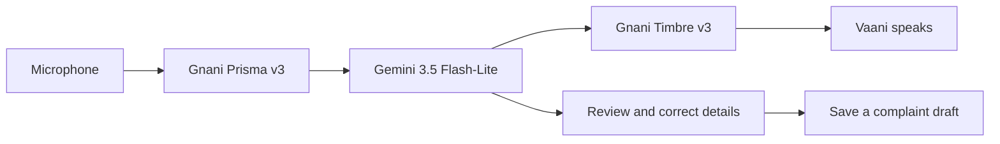

# Civic Sathi

**Your voice. Your grievance. A simpler first step toward being heard.**

Civic Sathi is a voice-first AI grievance assistant for people across India. Its assistant, **Vaani**, helps users explain a problem in their own words, answer useful follow-up questions, review the details, and prepare an editable complaint draft.

[Open Civic Sathi](https://civic-sathi-nine.vercel.app/) · [Current voice-app source](https://github.com/suuuuuuhas/om-vaani/tree/codex/vaani-streaming/civicbridge-app)

> Independent prototype, not a government service. Preparing or saving a draft does **not** file a complaint. Demo case references and timelines are synthetic; they are not official acknowledgements.

## What it does

- Offers a conversational intake experience with an animated Vaani avatar, captions and a text alternative.
- Provides interface translations for English, Hindi and Telugu.
- Uses Gnani speech recognition and speech synthesis, with Gemini for conversational replies and structured grievance analysis.
- Organizes complaint details for review and correction before a draft is saved.
- Keeps prototype cases in the current browser and exposes them through a dashboard and case-detail pages.
- Includes consumer, EPFO and railway demo workflows with source-linked next-action guidance.

For example, a user can explain that a mixer arrived damaged and a refund has not arrived. Vaani can ask about the purchase, seller contact and requested resolution while the application prepares details for review.

## Voice architecture



The current voice branch contains a server-side WebSocket session that bridges streaming recognition, Gemini response generation and speech output. It also contains REST transcription and speech routes. Provider credentials stay on the server.

The streaming session currently selects `gemini-3.5-flash-lite` directly in `civicbridge-app/src/lib/voice/stream-session.ts`. `GEMINI_MODEL` configures the separate structured-analysis client; changing that variable alone does not change the streaming model. Timbre uses `timbre-v3.0` with the Shivani voice.

**Streaming code is not a guarantee of Gemini Live-like reliability.** Provider endpoint access, account quota, hosting support, language accuracy and browser audio behavior need verification in the deployment being used. Natural microphone conversations and interruptions remain areas for improvement. No measured production latency or universal language-accuracy claim is made here.

## Run the current app

Requirements: Node.js 20 or later, npm, and Chrome or another browser with microphone support. Microphone capture requires localhost or HTTPS.

The latest voice work is on `codex/vaani-streaming`; the default branch can contain an earlier version.

```bash
git clone https://github.com/suuuuuuhas/om-vaani.git
cd om-vaani
git switch codex/vaani-streaming
cd civicbridge-app
npm ci
```

Copy `civicbridge-app/.env.example` to `civicbridge-app/.env.local`, then add your own credentials:

| Variable | Purpose |
| --- | --- |
| `GNANI_STT_API_KEY` | Separate Gnani Prisma speech-recognition credential |
| `GNANI_TTS_API_KEY` | Separate Gnani Timbre speech-synthesis credential |
| `GEMINI_API_KEY` | Gemini conversational reasoning and analysis |
| `GEMINI_MODEL` | Optional model setting for structured analysis; see the streaming-model note above |
| `SUPABASE_URL` | Hosted rate-limit database URL |
| `SUPABASE_KEY` | Private server credential for hosted rate limiting |

The template also includes optional legacy OpenAI-compatible settings. They are not required for the Gemini voice session. Without an AI key, some structured-analysis flows can use deterministic offline rules; live voice conversation still requires the speech and Gemini credentials.

```bash
npm run dev
```

Open [localhost:3000](http://localhost:3000). Local development previews the interface and ordinary API routes. The streaming session route uses Vercel's WebSocket upgrade integration; plain `next dev` is not sufficient to verify that hosted connection. Use a compatible Vercel environment for end-to-end streaming checks. Hosted requests require the shared rate-limit configuration; local development uses an in-memory limiter.

## Repository map

| Path | Contents |
| --- | --- |
| `civicbridge-app/` | Current Next.js Civic Sathi application |
| `civicbridge-app/src/app/api/voice/` | Streaming session, transcription and speech routes |
| `civicbridge-app/src/lib/voice/` | Provider orchestration for the streaming voice session |
| `civicbridge-app/src/app/api/ai/` | Triage, status explanation and escalation routes |
| `app/`, `web/`, `requirements.txt` | Earlier Python/FastAPI Om Vaani application |
| `docs/om-vaani-legacy.md` | Preserved setup and implementation notes for the earlier app |

The repository retains the original `om-vaani` name; the current product is **Civic Sathi**. The earlier Python app and current Next.js app are separate implementations.

## Development checks

Run these from `civicbridge-app/`:

```bash
npm run typecheck
npm run lint
npm test
npm run build
npm run test:e2e
```

These commands cover different checks; listing them does not claim they have all passed for every checkout. Real microphone, provider failure, quota and interruption tests must also be performed in a supported browser and deployment.

## Privacy and current limitations

- Consent is requested before provider processing. Audio goes to Gnani; complaint text is processed by the configured reasoning provider. Provider terms and retention policies apply.
- Never commit credentials or put private server keys in `NEXT_PUBLIC_*` variables. Local environment files are ignored by Git.
- Browser case storage is device/browser-specific, not authenticated cross-device case sync. Supabase rate limiting does not turn local drafts into cloud-synced cases.
- Do not include Aadhaar, OTPs, passwords or bank details in demo complaints. Input safeguards are not a guarantee that all sensitive data will be detected.
- No official complaint filing, government status integration or verified filing reference is provided.
- WhatsApp is outside the current Civic Sathi voice-app workflow.
- English, Hindi and Telugu interface support does not establish speech quality for every speaker or language. Test with real speakers before making accuracy claims.

## Built with

Next.js App Router, React, TypeScript, Tailwind CSS, Gnani Prisma/Timbre, Gemini, Zod, Vitest and Playwright. Vercel hosts the current portal; Supabase supports shared hosted rate limiting.

The product direction, requirements and iteration were user-led, with AI-assisted implementation and testing. This repository is a prototype and does not claim government affiliation, official adoption or successful complaint resolution.
