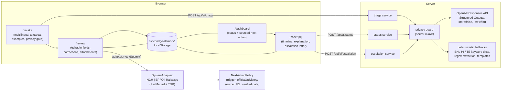

# Civic Sathi (project Om Saty)

This copy combines CivicBridge's grievance workflows with Vaani Saty, Gnani Prisma v3 automatic language detection, Gnani Timbre speech, and Gemini triage. Speech and AI credentials are server-side. The interface currently has English, Hindi and Telugu translations; detected speech can be transcribed in the ten languages supported by Prisma, and the AI is asked to respond in the detected language. Verify each language with real speakers before claiming accuracy.

Cases and submission references in this prototype are simulated and stored in the current browser. Existing Om Vaani drafts are not migrated. The app does not submit to government systems or track official status. Voice recordings go to Gnani; written complaint text goes to Gemini after the user agrees. Use synthetic test data until the storage and identity model is ready for real users.

**Independent hackathon prototype - not a government service.** CivicBridge helps a citizen describe a grievance in their own words, identifies which redressal system fits (National Consumer Helpline, EPFO, or Indian Railways via RailMadad / IRCTC TDR), prepares an editable case with synthetic evidence, tracks it in the browser, and suggests a **sourced next action** when it is time to escalate.

The seeded citizen, case IDs (`CB-2026-#####`), references, attachments and status events are **synthetic**. Case records live in the current browser under `civicbridge-demo-v1`. Voice recordings are sent to Gnani and AI requests are sent to Gemini when the user consents.

## Quickstart

```bash
npm install
npm run dev          # http://localhost:3000
```

Without the Gemini key, grievance analysis falls back to deterministic offline rules and the UI says so ("Offline rules"). Voice requires the Gnani STT and TTS keys.

### Environment variables (`.env.local`, see `.env.example`)

| Variable | Required | Purpose |
|---|---|---|
| `GEMINI_API_KEY` | For AI | Google Gemini reasoning key, server only. |
| `GEMINI_MODEL` | No | Defaults to `gemini-3.6-flash`. |
| `GNANI_STT_API_KEY` | For voice input | Gnani Prisma v3 key, server only. |
| `GNANI_TTS_API_KEY` | For voice output | Gnani Timbre key, server only. |
| `SUPABASE_URL`, `SUPABASE_KEY` | Hosted | Private server credentials used for shared rate limiting. |

With Gemini configured, live mode uses Gemini structured output and falls back to offline rules when it is unavailable. The legacy OpenAI-compatible adapter remains for existing test fixtures and optional configurations.

## Scripts

```bash
npm run typecheck    # tsc --noEmit
npm run lint         # eslint (next/core-web-vitals)
npm test             # vitest: unit + contract tests
npm run test:e2e     # Playwright: journey, persistence, failure modes, axe scans
npm run build        # production build
```

## Architecture



Pages are Server Component shells; interactive islands (intake, review, dashboard, case detail, locale provider) are client components reading the local store.

## Real versus mocked

| Capability | Status |
|---|---|
| Grievance triage/extraction (AI) | Real OpenAI Responses API when `OPENAI_API_KEY` is set; otherwise offline keyword dictionaries + regex patterns |
| Status explanations | Same dual-mode as above |
| Escalation letters | Same dual-mode; always editable, copyable, downloadable UTF-8 text |
| Case submission | Mocked - generates `CB-2026-#####`, a synthetic system reference, and a local timeline. Nothing is sent to any government portal |
| Attachments | Bundled fictional SVG receipt/screenshot with mock field extraction |
| Citizen identity | One-click fictional demo citizen; no names or phone numbers collected |
| Escalation policies | Authored from official sources below; each stores trigger type, official/advisory flag, source URL, verification date |

## Privacy approach

- Blocked before any processing (browser **and** server): Aadhaar (incl. masked), PAN, OTP/PIN wording + codes, passwords, CVV, banking login credentials, Luhn-valid card runs, account numbers.
- Contextually allowed synthetic references: PNR, UAN (12 digits only near "UAN"), order/transaction/complaint IDs.
- Free text clamped to 4,000 chars; requests validated with Zod on the server.

## Escalation policy sources (verified where noted)

| System | Trigger | Timing | Source (checked 2026-08-22) |
|---|---|---|---|
| NCH | Elapsed ≥ 30 days awaiting response | Advisory ("responses are expected within 30 days"; suggests considering e-Jagriti, not entitlement) | consumerhelpline.gov.in/public/convergenceprogram - fetched & verified |
| EPFO | Pending ≥ 15 days or unsatisfactory response | Advisory (RPFC / CPGRAMS suggested cautiously). Site unreachable at verification; note stored | epfindia.gov.in/site_en/Contact.php - attempted |
| RailMadad | Unsatisfactory closure, or stalled ≥ 45 days | Advisory - no fixed deadline published; "Railway Ombudsman" omitted until officially verified | railmadad.indianrailways.gov.in - fetched; CPGRAMS: pgportal.gov.in |
| Railway TDR | Filing deadline | Official - TDR up to 4h before departure (confirmed), 30min (RAC/partial); track refund after chart preparation | contents.irctc.co.in/en/eticketCancel.html - fetched & verified |

## Limitations

- Prototype only: no real submissions, authentication, admin analytics, browser voice input, or file uploads.
- Timeline entries for seeded cases are static; next-action indicators are computed live from policy thresholds.
- Escalation guidance is informational and source-linked; it is not legal advice.

## Tool disclosure

Built with Next.js 15 (App Router), React 19, Tailwind CSS 4 (custom token system, Noto Sans families), Zod, the OpenAI SDK, Vitest, and Playwright with @axe-core. AI assistance (Codex-class coding model) scaffolded, implemented, and tested the codebase under human direction; all third-party libraries are listed in `package.json`.
